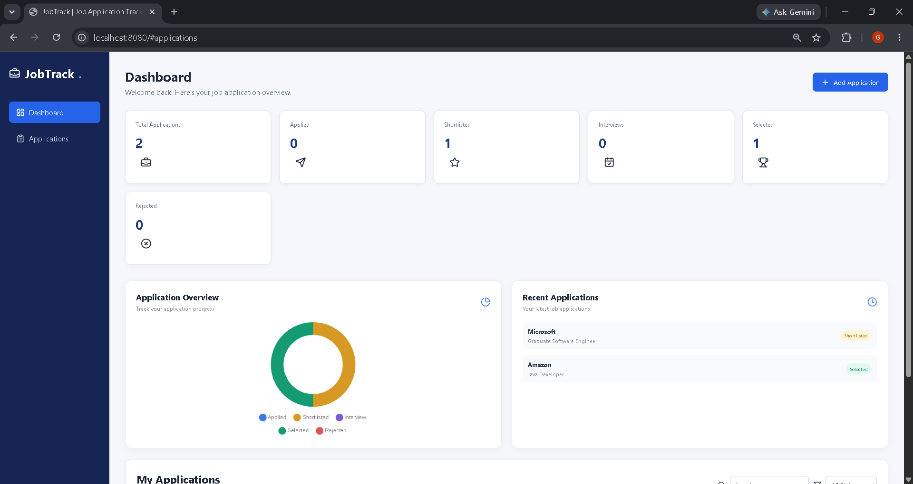
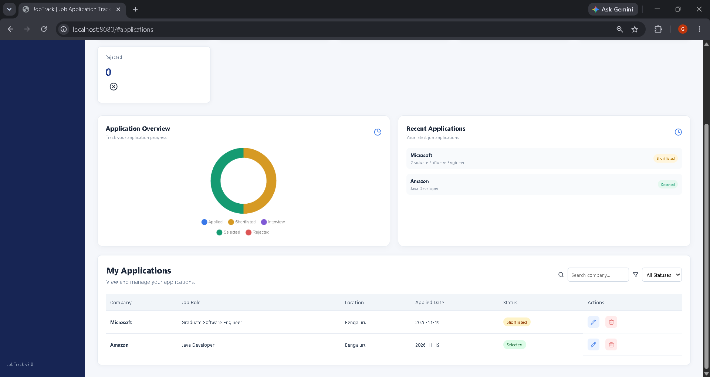
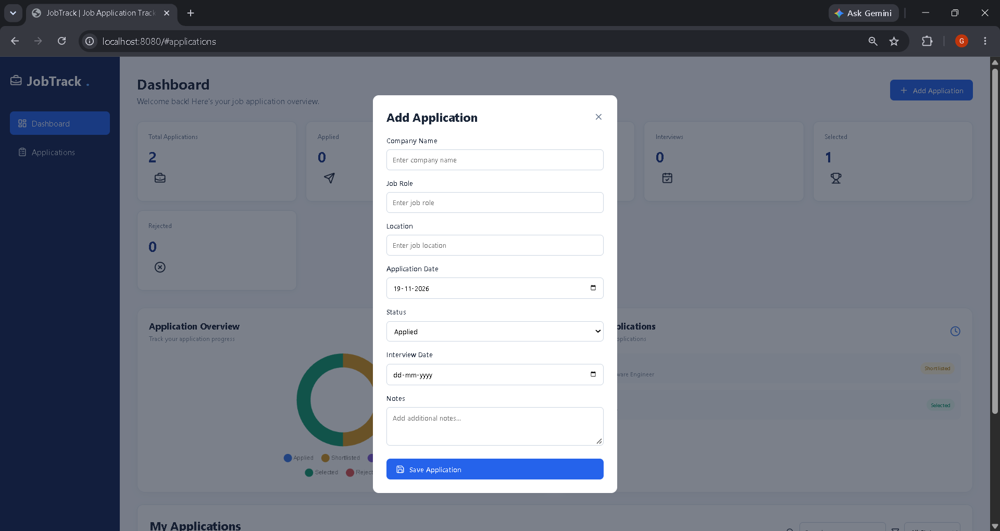

# JobTrack – Job Application Tracker

A full-stack web application designed to help job seekers organize, manage, and track their job applications through a centralized dashboard.

## Overview

JobTrack simplifies the job application tracking process by allowing users to maintain application records, monitor recruitment progress, and view application statistics in one place.

The application uses **Java and Spring Boot** for backend development, **MySQL** for data persistence, and **HTML, CSS, and JavaScript** for the frontend.
## Screenshots

### Dashboard


### Applications


### Add / Edit Application


## Features

- **Dashboard:** View overall job application statistics.
- **Application Management:** Add, view, update, and delete job applications.
- **Search:** Find applications by company name.
- **Status Filtering:** Filter applications based on their current status.
- **Application Tracking:** Track the following statuses:
  - Applied
  - Shortlisted
  - Interview
  - Selected
  - Rejected
- **Analytics:** Visualize application status distribution using a doughnut chart.
- **Recent Applications:** View the five most recently submitted applications.
- **Form Validation:** Validate required fields and handle invalid requests.
- **Responsive Interface:** Access application information through a clean web dashboard.

## Technology Stack

| Category | Technologies |
|---|---|
| Backend | Java, Spring Boot |
| Data Access | Spring Data JPA, Hibernate |
| Database | MySQL |
| Frontend | HTML, CSS, JavaScript |
| API | RESTful APIs |
| Build Tool | Maven |
| API Testing | Postman |
| Version Control | Git, GitHub |
| Libraries | Chart.js, Lucide Icons |

## Application Architecture

The application follows a layered architecture:

```text
Frontend (HTML, CSS, JavaScript)
              |
              v
       REST Controller
              |
              v
          Service
              |
              v
         Repository
              |
              v
        Spring Data JPA
              |
              v
           MySQL
```

## Project Structure

```text
JobTrack/
│
├── src/
│   ├── main/
│   │   ├── java/com/jobtrack/jobtrack/
│   │   │   ├── controller/
│   │   │   │   └── JobApplicationController.java
│   │   │   ├── entity/
│   │   │   │   ├── JobApplication.java
│   │   │   │   └── ApplicationStatus.java
│   │   │   ├── exception/
│   │   │   │   ├── GlobalExceptionHandler.java
│   │   │   │   └── ResourceNotFoundException.java
│   │   │   ├── repository/
│   │   │   │   └── JobApplicationRepository.java
│   │   │   ├── service/
│   │   │   │   └── JobApplicationService.java
│   │   │   └── JobtrackApplication.java
│   │   │
│   │   └── resources/
│   │       ├── static/
│   │       │   ├── index.html
│   │       │   ├── style.css
│   │       │   └── script.js
│   │       └── application.properties
│   │
│   └── test/
│
├── pom.xml
├── mvnw
├── mvnw.cmd
└── README.md
```

## Database Configuration

JobTrack uses MySQL as its relational database.

1. Create the database:

```sql
CREATE DATABASE jobtrack_db;
```

2. Configure the database connection in `src/main/resources/application.properties`:

```properties
spring.application.name=jobtrack

spring.datasource.url=jdbc:mysql://localhost:3306/jobtrack_db
spring.datasource.username=root
spring.datasource.password=${DB_PASSWORD}

spring.jpa.hibernate.ddl-auto=update
spring.jpa.show-sql=true
spring.jpa.properties.hibernate.format_sql=true
```

3. Set your MySQL password as an environment variable.

**Windows PowerShell:**

```powershell
$env:DB_PASSWORD="your_mysql_password"
```

Replace the example with your own MySQL password. Never commit actual database credentials to GitHub.

## Run Locally

### Prerequisites

- Java Development Kit (JDK 21 recommended)
- MySQL Server 8.0 or compatible
- Git

### Installation

1. Clone the repository:

```bash
git clone https://github.com/vicky124z/JobTrack.git
```

2. Navigate to the project directory:

```bash
cd JobTrack
```

3. Create the MySQL database and configure the environment variable as described above.

4. Start the Spring Boot application:

**Windows:**

```powershell
.\mvnw.cmd spring-boot:run
```

**Linux/macOS:**

```bash
./mvnw spring-boot:run
```

5. Open the application in your browser:

```text
http://localhost:8080
```

## REST API Endpoints

Base URL: `/api/applications`

| HTTP Method | Endpoint | Description |
|---|---|---|
| POST | `/api/applications` | Create an application |
| GET | `/api/applications` | Retrieve all applications |
| GET | `/api/applications/{id}` | Retrieve an application by ID |
| PUT | `/api/applications/{id}` | Update an application |
| DELETE | `/api/applications/{id}` | Delete an application |
| GET | `/api/applications/search?company=Google` | Search by company |
| GET | `/api/applications/filter?status=APPLIED` | Filter by status |

## Application Data Model

Each job application contains the following information:

| Field | Description |
|---|---|
| ID | Unique application identifier |
| Company Name | Name of the company |
| Job Role | Position applied for |
| Location | Job location |
| Application Date | Date of application |
| Status | Current recruitment status |
| Interview Date | Scheduled interview date |
| Notes | Additional application details |

## API Testing

REST API endpoints were tested using **Postman**, including:

- Creating and retrieving application records.
- Updating and deleting existing records.
- Searching by company name.
- Filtering by application status.
- Handling invalid input through validation.
- Handling requests for non-existent application IDs.

## Future Enhancements

- User authentication and individual user accounts.
- Email notifications for interview reminders.
- Advanced application analytics.
- Cloud deployment.

## Author

**Vignesh B K**

- GitHub: [vicky124z](https://github.com/vicky124z)
- LinkedIn: [Vignesh B K](https://www.linkedin.com/in/vignesh-b-k-164b5236a/)

---

*JobTrack – Organize applications. Track progress. Stay career-focused.*